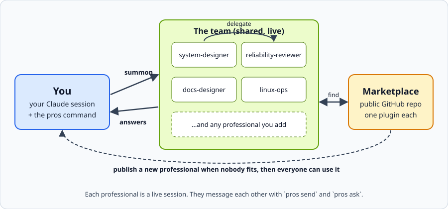

# Professionals

**A team of AI specialists for Claude Code. Summon one, hand it work, and let it call in the others.**

<p align="center"></p>

## What is this

- A **professional** is a specialist Claude session with a narrow job: system design, reliability review, docs, voice pipelines, Linux ops, and more.
- Any Claude session with the `professionals` skill can look one up, summon it, send it work and get answers back. Professionals can summon each other.
- When nobody fits, a new professional is written, tested and published here for everyone.

## Start in one paste

Paste this into Claude Code:

```
Install the Professionals system for me: run `claude plugin marketplace add DgxSparkLabs/professionals` and `claude plugin install professionals@professionals`, then run `~/.claude/plugins/marketplaces/professionals/plugins/professionals/bin/pros doctor --link` and show me `~/.local/bin/pros list`.
```

You need Claude Code 2.1.224 or newer, `tmux` and `python3`. If one is missing, `pros doctor` says which and how to install it.

**Why it is safe:** everything runs on your machine, inside your own Claude Code permissions. Every request has a deadline, the number of live professionals is capped, and a message from a peer is a request, never an order. Details in [Safety and limits](#safety-and-limits).

## 60-second tour

Output below is from a real run (Claude Code, model sonnet), shortened.

**1. Summon.** Start a specialist in its own live session.

```
$ pros summon reliability-reviewer --scope global
```

**2. Ask.** Send it a task and wait up to 90 seconds. The answer comes back tagged with the same task id.

```
$ pros ask reliability-reviewer "List 3 failure cases of a tmux message bus in one line each" --wait 90
sent m-0b2f4c09d2 task=t-7279b8a7 status=queued
[pro-msg id=m-b72b1ec540 from=reliability-reviewer to=user task=t-7279b8a7 kind=reply ...]
1. Lost message: send-keys into a busy, copy-mode or dead pane drops or garbles the text, and the sender gets no ack (P0).
2. Dead hang: the sender waits for a reply from a crashed or restarted session with no deadline and blocks forever (P1).
3. Duplicate or reordered delivery: a restart or retry replays a message, with no idempotency key to stop an action running twice (P1).
```

**3. Delegate.** Give it a task with a part outside its scope. It hands that part to the right professional and combines the answers. Here `reliability-reviewer` sent the writing part to `docs-designer`; the message log shows the chain:

```
reliability-reviewer -> docs-designer task answered chain=reliability-reviewer>docs-designer
docs-designer -> reliability-reviewer reply answered chain=reliability-reviewer>docs-designer
reliability-reviewer -> user reply answered chain=reliability-reviewer
```

**4. Grow.** No professional fits your job? Say "Create a professional that audits systemd unit hardening" and your session summons `professional-smith`, which writes, tests and validates it. By hand: `pros new my-pro --purpose "..." --tags a,b`, then `pros validate my-pro`. (This step is not in the recorded run; see [Add your own professional](#add-your-own-professional).)

Full recorded run: [tests/fixtures/real-run-1.md](tests/fixtures/real-run-1.md).

## The professionals

| Professional | What it does | Install name |
|---|---|---|
| `system-designer` | Turns a goal into components, interfaces, failure modes and a build order | `pro-system-designer` |
| `reliability-reviewer` | Finds dead hangs, races, lost messages and missing deadlines | `pro-reliability-reviewer` |
| `docs-designer` | READMEs that explain at a glance, with diagrams | `pro-docs-designer` |
| `voice-pipeline-engineer` | Real-time voice agents: VAD, end-of-turn, barge-in, latency | `pro-voice-pipeline-engineer` |
| `linux-ops` | systemd units, hardening, timers, journald, VMs | `pro-linux-ops` |
| `speckit-driver` | Drives the spec-kit flow from specify to implement | `pro-speckit-driver` |
| `exhaustive-researcher` | Complete, dated, sourced research with coverage counts | `pro-exhaustive-researcher` |
| `professional-smith` | Creates, trains, validates and publishes new professionals | `pro-professional-smith` |
| `ship-gatekeeper` | Checks a change against the repo's own rules before merge: SHIP or DON'T SHIP with the exact missing items (created by `professional-smith`) | `pro-ship-gatekeeper` |
| `systemd-hardening-auditor` | Audits a systemd service and proposes a hardened drop-in with the risk of each line (created by `professional-smith`) | `pro-systemd-hardening-auditor` |
| `whatsapp-engineer` | WhatsApp Cloud API vs linked-device clients, sessions, webhooks, ban risk | `pro-whatsapp-engineer` |
| `telegram-engineer` | Telegram bots vs user clients, flood limits, sessions, calls | `pro-telegram-engineer` |
| `linkedin-messaging-engineer` | LinkedIn messaging and invites with quotas, pacing and throttle stops | `pro-linkedin-messaging-engineer` |
| `instagram-messaging-engineer` | Instagram DM via the Meta messaging API, review, window, webhooks | `pro-instagram-messaging-engineer` |
| `facebook-messenger-engineer` | Messenger Platform for pages: webhooks, window and tags, handover | `pro-facebook-messenger-engineer` |

Each one is also a plain skill, so you can install a single persona on its own: `claude plugin install pro-linux-ops@professionals`.

## How it works

1. **Summon.** `pros summon reliability-reviewer` starts the professional in its own live session (or reuses the one already running). Sessions live on one tmux server, so every professional can see the team.
2. **Talk.** `pros ask reliability-reviewer "Give me three failure cases for this design"`. Messages carry a header with sender, task id and reply address, and the answer comes back tagged with the same task id. A busy professional gets the message queued and delivered when it is free. Nothing is typed into the middle of its work.
3. **Delegate.** Every professional checks the task against its scope. Outside it, the professional hands that part to someone better, or declines with a reason. The delegation chain travels with the message, so loops are refused.
4. **Grow.** No fit? `professional-smith` writes a new definition from the template, practices it on sample tasks, validates it and publishes it.

Useful commands: `pros list`, `pros add <dir>`, `pros sessions <name>`, `pros search <words>`, `pros team`, `pros attach <name>`, `pros stop <name>`, `pros doctor`. The full list is in the skill: `plugins/professionals/skills/professionals/SKILL.md`.

## Your own folders as professionals

Any folder with its own `CLAUDE.md`, `AGENTS.md` or `.claude/` can be a professional: the instructions already there are its definition.

```
pros add ~/code/my-repo            # once; yours alone to run, a professional cannot do it
pros summon my-repo                # starts (or resumes) a session inside that folder
pros ask my-repo "Where is the retry logic? Cite path:line."
```

It was tried on a real WhatsApp-helper repo: added, summoned, asked where messages are stored, stopped, summoned again (`resumed=<id>`), and the follow-up was answered from the earlier context.

- **Resume.** Every session has an id kept in a history. The next `pros summon` resumes the last good session; `--fresh` starts clean, `--fork` copies the context into a new session, `pros rate <name> bad` makes it start fresh next time.
- **Allowlist.** Only professionals on your list can be summoned or messaged. `add`, `remove`, `enable`, `disable`, `keep` and `rate` refuse inside a professional session, and professionals cannot read or edit the registry. A session that you give generic shell access can still act as you: grant that sparingly.
- **Folder code.** `pros add` prints any hooks or MCP servers the folder would run and remembers a hash of its instructions and settings. If they change, summon is refused until you run `pros add <dir> --refresh`. Folders with hooks or MCP need `--trust-code` before the trust dialog is answered for you.
- **Manage.** `pros list` shows everyone with state and last session; `pros keep <name>` stops the idle reaper from ending one; `pros sessions <name>` shows the history; `pros remove <name>` never touches the folder.

The full specification is in [docs/spec/](docs/spec/spec.md).

## Safety and limits

- **Caps.** At most 6 live professionals, chain depth at most 4, a budget of summons per hour, and idle professionals stop after 30 minutes. All are configurable in `~/.professionals/config.json`.
- **Deadlines.** Every request has one. A stuck or dead target is reported as `stuck: <reason>`, never waited on forever. A late reply is still returned by `pros wait`.
- **Wake on message.** `pros send` starts an allowlisted professional that is not running (the caps still apply); the message is stored first, so a failed start never loses it. `--no-wake` refuses instead.
- **Permissions.** Professionals start in `dontAsk` mode with an allowlist taken from their `tools:` line, intersected with a fixed safe list. A missing permission is a clear denial, never a hidden dialog. Your own Claude Code permission settings always apply, and nothing here widens them.
- **Sandbox.** Professionals run in the Claude Code sandbox when your machine supports it (it needs `bubblewrap` and `socat`, and some Linux setups such as stock Ubuntu 24.04+ block it; `pros doctor` tells you). Either way, read access is denied to sensitive paths you list in `deny_paths`, and the shell is limited to an allowlist.
- **Trust.** Only professionals from marketplaces you have added can be summoned. A professional is text that instructs an agent, so read one before you add a marketplace you do not know.
- **Peers are not bosses.** A message from another professional is a request. It never outranks what you told the session.

## Audit data on your machine

`pros` keeps a local audit of what it does, **on by default, in metadata mode**. It never leaves your machine unless you export it yourself.

- **What is recorded (metadata only):** ids (message, run, session, professional), event kinds and states (created, claimed, delivered, answered, failed, refused, spawn, stop), counts and sizes (body bytes, attempts, chain length, token counts), times and deadlines, hashes of project and transcript paths, and, when you enter them, verdicts, rubric ids and criteria outcomes. Full field list: [docs/spec/audit/events.md](docs/spec/audit/events.md). **Message text, prompts, replies, tool arguments or results, file paths and stack text are never recorded** (content capture does not exist in this release).
- **Where:** `$PRO_HOME/audit/` (`~/.professionals/audit/` by default). The directory is mode 0700; the spool files, `audit.db` and the owner token are mode 0600.
- **Retention:** 90 days by default for events (change it with `pros audit serve --manage`, Retention). Nothing is deleted on a timer; the setting is the default cutoff of a purge.
- **Turn capture off:** `export PRO_AUDIT=off`, or put `"capture_mode": "off"` in `$PRO_HOME/config.json`. `pros` then records nothing new. A one-time notice on stderr tells you this the first time capture starts in a home.
- **Look at it:** `pros audit status`, `pros audit summary`, `pros audit import`, `pros audit serve` (loopback dashboard).
- **Export:** `pros audit export --preview` shows what would be written; `pros audit export --out DIR --yes` writes a redacted export (`--format jsonl|csv|html`).
- **Purge:** `pros audit serve --manage`, open the printed URL, Manage, Purge (type `purge` to confirm). To delete everything: turn capture off, then delete the `$PRO_HOME/audit/` directory.

Operations guide: [docs/audit-operations.md](docs/audit-operations.md). Privacy rules: [docs/spec/audit/privacy.md](docs/spec/audit/privacy.md).

## Add your own professional

1. Ask your session: "Create a professional that audits systemd unit hardening." It summons `professional-smith`, which does the rest.
2. Or by hand: `pros new my-pro --purpose "..." --tags a,b`, edit `skills/my-pro/SKILL.md` (use `templates/professional/` as the guide), run `pros validate my-pro`, then `pros publish my-pro`.
3. You publish through a pull request. See [CONTRIBUTING.md](CONTRIBUTING.md).

## FAQ

**Does this cost extra?** Each professional is a full Claude Code session, so it uses your usage. Idle ones stop after 30 minutes and personas default to the `sonnet` model.

**Does it run in the cloud?** No. Every session runs on your own machine.

**Can I watch a professional work?** Yes. `pros attach <name>` prints the tmux command to join its session.

**What if tmux is missing?** `pros doctor` tells you and shows the install line for your system.

**Does it work without the paste?** Yes. Run the two `claude plugin` commands yourself, then `pros doctor --link`.

## License

MIT. See [LICENSE](LICENSE).
